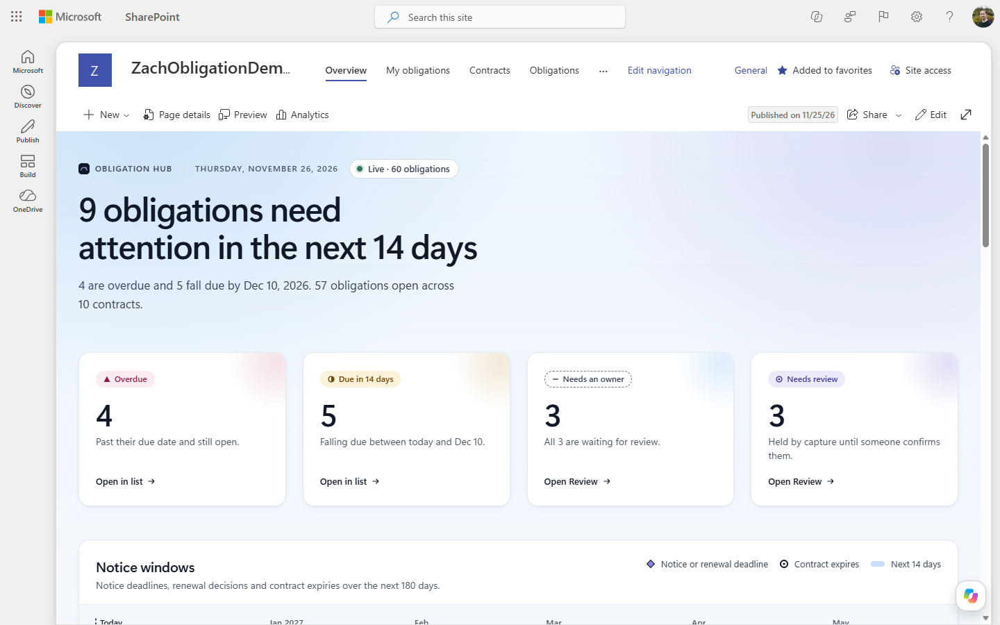
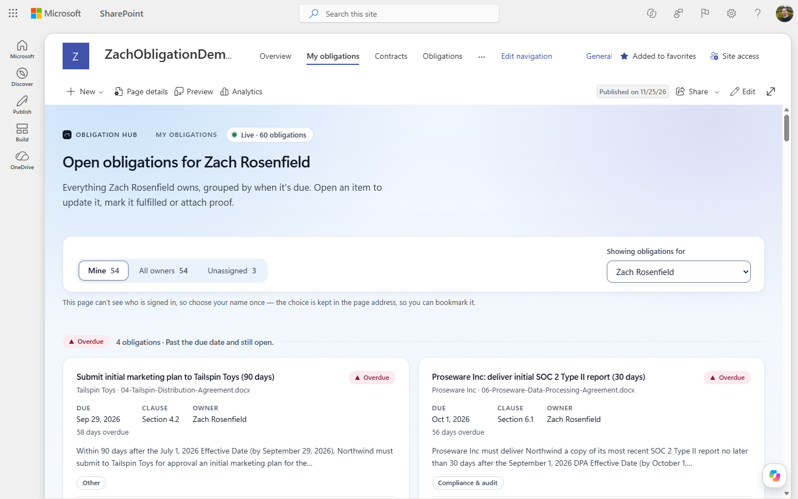
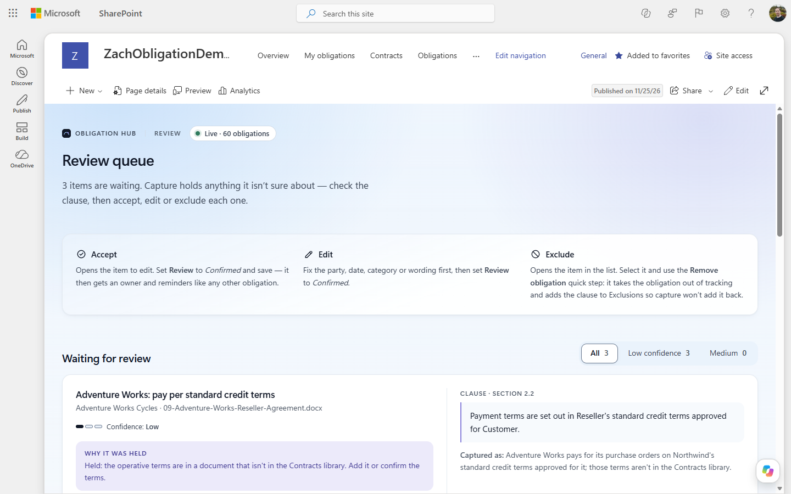
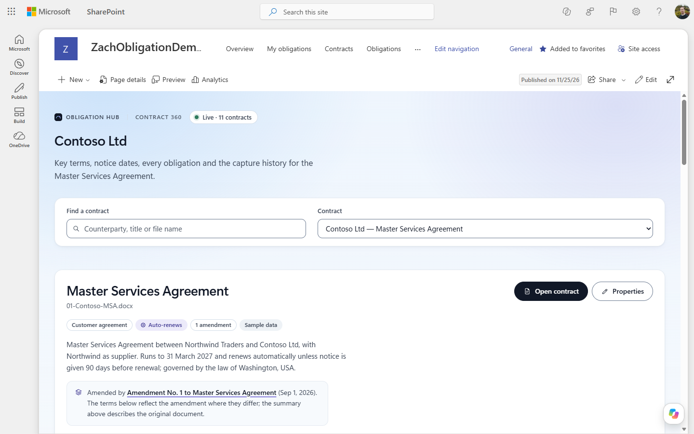
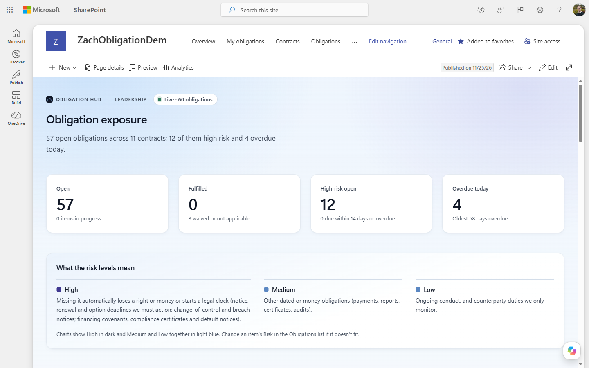
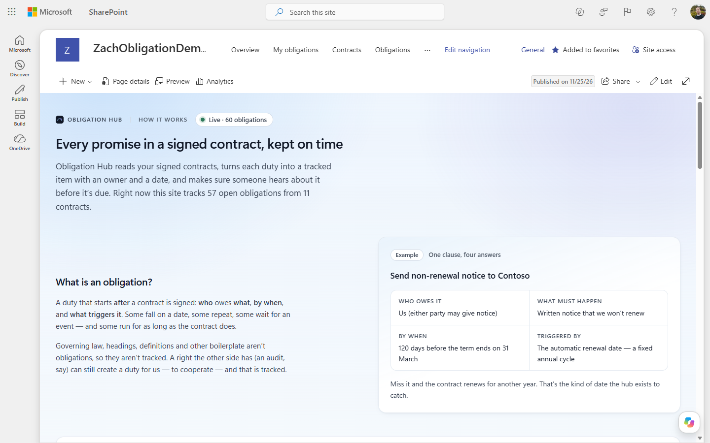
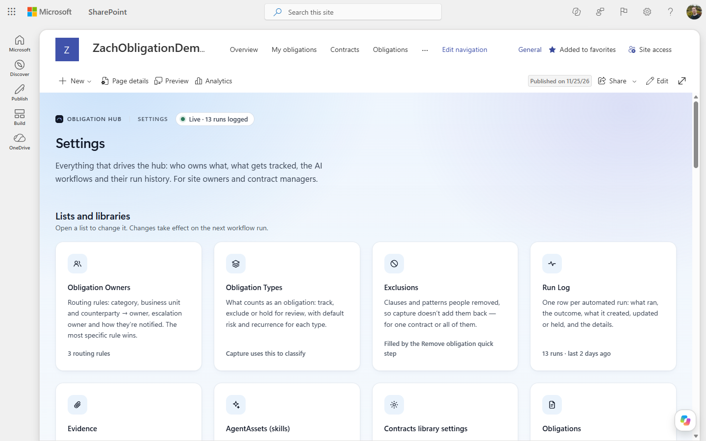

# Obligation Hub for SharePoint

> **Status: experimental solution sample.** A complete kit for test-site evaluation, not a production-ready contract management system. It was built and tested on a preview-enabled test tenant; deployment and tenant behaviour have not been verified as part of this repository import.

The Obligation Hub turns signed contracts into a register of what you owe and what you're owed. Drop a contract into a SharePoint library and Copilot reads it, lists each obligation with the clause it comes from, routes it to an owner, and reminds people before deadlines. Everything lives on one SharePoint site: lists for the data, Copilot skills for the logic, AI workflows to run them, and pages to see it all.

> **Unofficial, personal and unsupported.** This is my personal side project, not a Microsoft product, template or recommendation. Microsoft hasn't reviewed it and doesn't support it. It doesn't give legal advice: it records what your contracts say, and a person has to check it. Read the script before you run it, try it on a test site first, and use it at your own risk. Issues and pull requests are welcome, but I can't promise a fix.

## Running demo

[Open the live Obligation Hub demo](https://microsoft.sharepoint-df.com/sites/zachobligationdemo). The site currently demonstrates Northwind-style fictional contracts and obligations, including 11 contracts, 60 seeded obligations, review-held items, routing rules, run history and the seven hub pages.

| Page | What to show | Live link |
|---|---|---|
| Home | Overdue, due-soon, unowned and review queues; notice timeline; workflow health | [Home](https://microsoft.sharepoint-df.com/sites/zachobligationdemo) |
| My obligations | The native owner-filtered work queue | [My obligations](https://microsoft.sharepoint-df.com/sites/zachobligationdemo/SitePages/MyObligations.html) |
| Review | Low-confidence obligations held for a person to confirm or exclude | [Review queue](https://microsoft.sharepoint-df.com/sites/zachobligationdemo/SitePages/ReviewQueue.html) |
| Contract 360 | One contract, its amendments and its related obligations | [Contract 360](https://microsoft.sharepoint-df.com/sites/zachobligationdemo/SitePages/Contract360.html) |
| Leadership | Open, overdue and high-risk exposure across the register | [Leadership](https://microsoft.sharepoint-df.com/sites/zachobligationdemo/SitePages/Leadership.html) |
| How it works | Operating loop, roles, limitations and amendment handling | [How it works](https://microsoft.sharepoint-df.com/sites/zachobligationdemo/SitePages/HowItWorks.html) |
| Settings | Routing, types, exclusions, run history and workflow prompts | [Settings](https://microsoft.sharepoint-df.com/sites/zachobligationdemo/SitePages/Settings.html) |

The most reliable links to the live data are [Obligations](https://microsoft.sharepoint-df.com/sites/zachobligationdemo/Lists/Obligations), [Contracts](https://microsoft.sharepoint-df.com/sites/zachobligationdemo/Contracts/), [Obligation Owners](https://microsoft.sharepoint-df.com/sites/zachobligationdemo/Lists/Obligation%20Owners/AllItems.aspx), [Run Log](https://microsoft.sharepoint-df.com/sites/zachobligationdemo/Lists/Run%20Log/AllItems.aspx) and [AgentAssets](https://microsoft.sharepoint-df.com/sites/zachobligationdemo/AgentAssets/Forms/AllItems.aspx).

### Guided walkthrough

1. Start on **Home**. Point out the attention counts, the Contoso notice deadline and the workflow-health summary.
2. Open **Contracts** and add or select a contract. Explain that capture reads the clause, creates obligations and marks uncertain terms for review.
3. Open **Obligations** and filter to **Open by due date**. Show the item, source clause, owner, timing, risk and evidence fields.
4. Open **My obligations** and **Review**. Show the difference between an assigned obligation and a held item waiting for a person.
5. Use Copilot on the site to ask for an upcoming renewal or an overdue counterparty risk. Ask for clause citations and links.
6. Use the **Mark fulfilled** quick step with evidence, or show the existing record and recurring next occurrence.
7. Finish on **Leadership** or **How it works** to show the register-level exposure and what the hub does not automate.

### Screenshots

These screenshots were captured from the running demo site.

| Home | My obligations |
|---|---|
|  |  |

| Review | Contract 360 |
|---|---|
|  |  |

| Leadership | How it works | Settings |
|---|---|---|
|  |  |  |

## What you get

| Piece | What it does |
|---|---|
| **Contracts** library | Holds signed contracts and amendments, with key-term columns (counterparty, dates, renewal, notice period, value) that autofill can fill in |
| **Obligations** list | The register: one row per obligation, with the clause quoted, who owes it, the due date or trigger, owner, status, timing, risk and review state. Eight views, including Open by due date, Triggered and ongoing, My obligations, Needs owner, Needs review and a calendar |
| **Obligation Owners**, **Obligation Types**, **Exclusions** | Routing rules (who owns what), a 37-row catalogue of what to track or ignore, and the clauses people removed so they don't come back |
| **Run Log** and **Evidence** | One row per automated run, and a library for proof of fulfilment |
| **10 Copilot skills** | Capture, assign owners, daily sweep, digests, mark fulfilled, remove, a Q&A guide, setup and sample clean-up. They live in [`../../Skills/`](../../Skills/) |
| **6 AI workflow prompts** | Capture new and changed contracts, assign owners each morning, a daily sweep with reminders and escalation, a Monday owner digest and a Friday leadership digest |
| **3 quick steps** | Mark fulfilled, Remove obligation and Re-capture obligations, one click on a selected item |
| **7 pages** | Home, My obligations, Review queue, Contract 360, Leadership, How it works and Settings, with live list data |
| **Colour formatting** | Status, Timing, Risk and Review shown as coloured pills |
| **Site look** (script only) | Eight hub links in the site navigation (Overview, My obligations, Contracts, Obligations, Review, Leadership, How it works, Settings), an "Obligation Hub" theme, a logo and a compact header |
| **Fictional sample** | 11 sample contracts for a made-up company, an answer key, and the obligations already captured from them |

## What you need

- **A SharePoint site where you're an owner.** Use a test site first.
- **A tenant with the preview features turned on.** SharePoint AI workflows, HTML pages with live list data and Copilot site skills are preview features that may not be available in your tenant yet.  On other tenants the lists, views, formatting and quick steps still work; the automation and pages may not. See [known gaps](docs/known-gaps.md#11-preview-platform-features).
- **A Microsoft 365 Copilot licence** for everyone who uses Copilot in SharePoint, runs a quick step or creates a workflow.
- **For path C only:** Cowork with its SharePoint tools.

You **don't** need a tenant admin, Power Automate, Azure, an app registration or any server. Everything is created with site-owner rights.

## Three ways to set it up

| Path | Best for | Time |
|---|---|---|
| **A. Paste-in browser script** | The complete hub, with pages and optional sample data, in one go | About 10 minutes |
| **B. Ask Copilot in SharePoint** | No scripts; Copilot builds the lists after you confirm a plan | About 20 minutes, plus pages |
| **C. Cowork with SharePoint tools** | A guided conversation that can also upload the skills, pages and sample | About 30 minutes, with an approval card per change |

Prefer to click through it yourself? [SETUP.md](SETUP.md) has every step as a copyable Copilot prompt with a fallback.

### A. Paste-in browser script

[`deploy/deploy-obligation-hub.js`](deploy/deploy-obligation-hub.js) builds what [`deploy/spec.json`](deploy/spec.json) describes: the seven lists and libraries with their columns, views and colour formatting, the type catalogue and a default routing rule for you, nine skills (not `setup-obligation-hub`, which isn't needed once the hub is built), `SHAREPOINT.md` and `hub-settings.json` in AgentAssets, the seven pages, published, and the site look. It ends with one Setup row in the Run Log.

1. Open the target site in your browser, signed in as a site owner.
2. Open the browser's developer tools (F12) and go to the **Console**.
3. Read the script and set the options at the top, then paste it in and press Enter.
4. Keep the tab open until it finishes. It prints a summary and the finishing touches it can't do for you: the three quick steps, the six AI workflow prompts and an autofill prompt.

| Option | Default | What it does |
|---|---|---|
| `assetsBaseUrl` | This repository on GitHub (raw files, `master`) | Where the script downloads the kit's files from: the spec, page templates, formats, skills, `SHAREPOINT.md`, the settings template and the sample. Point it at your fork or your own copy. A built-in copy of the spec and formats is the fallback for the list build |
| `sampleData` | `true` | Uploads the 11 fictional sample contracts with their key terms (Sample data = Yes) and two example routing rules |
| `preCapturedSample` | `true` | With `sampleData`, also loads the 60 obligations already captured from those contracts and 13 sample Run Log rows, so the hub has data before any workflow runs |
| `shiftDatesToToday` | `false` | Moves every sample date forward by the days since 2026-11-24, so items stay overdue or due soon. Dates inside the Word files don't move |
| `pages` | `true` | Fills this site's list IDs into the seven pages and uploads them to Site Pages |
| `publishPages` | `true` | Publishes the pages. Drafts can't be seen by visitors or set as the home page |
| `setHome` | `false` | Makes Home the site's home page, after it's published |
| `companyName` | empty | Your legal name as written in contracts. Empty means the sample company when `sampleData` is on; otherwise the script asks |
| `leadershipEmails` | empty | Leadership digest recipients. Empty means you |
| `siteChrome` | `true` | Sets up the site's look (site owners only; skipped with a note for members): adds the eight hub links to the site navigation (the top navigation on a communication site; the site navigation switched to horizontal on a team site), never adding a link twice. With it on, Contracts and Obligations don't get separate navigation links |
| `replaceNavigation` | `false` | With `siteChrome`, also removes the site's default Documents, Pages and Site contents links. No other links are removed |
| `applyTheme` | `true` | With `siteChrome`, applies the "Obligation Hub" theme (dark blue primary, 9:1 contrast on white) |
| `setLogo` | `true` | With `siteChrome`, uploads the hub logo to Site Assets and makes it the site logo |
| `compactHeader` | `true` | With `siteChrome`, sets the header to Compact with no background emphasis |
| `pagesOnly` | `false` | Only fills in, uploads and publishes the pages, and applies the site look, on a site whose hub lists already exist (built with path B or [SETUP.md](SETUP.md)). Writes nothing else |
| `resume` | `false` | Continues a run that stopped part-way, skipping what already exists |

The script stops if any of the seven hub lists or libraries already exists, unless `resume` or `pagesOnly` is on. It never overwrites a list. To add the hub to a site that already has some of these lists, use path B, which adds only what's missing.

### B. Ask Copilot in SharePoint

1. Upload the [`setup-obligation-hub`](../../Skills/setup-obligation-hub/) folder (with its `references` folder) to **AgentAssets > Skills** on the site. **Settings > Site skills** is another way in, where available.
2. Ask Copilot in SharePoint: "Set up the Obligation Hub on this site." It asks for your company's legal name, leadership recipients, time zone and whether to turn on autofill, checks what already exists and shows a plan.
3. Reply **yes**. It builds the lists, libraries, views, formatting, quick steps, settings file, type catalogue and a default routing rule, then reports what it created, what it skipped and what's left.
4. Upload the other nine skill folders to **AgentAssets > Skills**, and [`assets/SHAREPOINT.md`](assets/SHAREPOINT.md) to the AgentAssets root.
5. For the pages, run the path A script with `pagesOnly: true` (and `setHome: true` if you want Home as the home page). It also adds the hub's navigation links, theme, logo and compact header. Or use the Cowork prompt "Fill in the hub's pages for this site". Pages need this site's list IDs filled in, which Copilot in SharePoint can't do.

It's safe to run again: it never deletes or overwrites anything and builds only what's missing.

### Copilot skills

All ten live in [`../../Skills/`](../../Skills/). Upload each folder to **AgentAssets > Skills**.

| Skill | What it does | Try asking |
|---|---|---|
| [`setup-obligation-hub`](../../Skills/setup-obligation-hub/) | Builds or repairs the hub's lists, settings and quick steps after one confirmation | "Set up the Obligation Hub on this site" |
| [`capture-obligations`](../../Skills/capture-obligations/) | Reads a contract and creates or updates its obligations | "Capture obligations from 01-Contoso-MSA.docx" |
| [`assign-obligation-owners`](../../Skills/assign-obligation-owners/) | Routes unowned, confirmed items using Obligation Owners | "Assign owners" |
| [`sweep-obligations`](../../Skills/sweep-obligations/) | Updates Timing, creates next occurrences, reminds and escalates | "Run the daily sweep" |
| [`obligation-owner-digest`](../../Skills/obligation-owner-digest/) | Sends each owner their week | "Send the owner digest" |
| [`obligation-leadership-digest`](../../Skills/obligation-leadership-digest/) | Sends leadership a weekly snapshot | "Send the leadership digest" |
| [`mark-obligation-fulfilled`](../../Skills/mark-obligation-fulfilled/) | Closes an item with evidence and creates the next occurrence | "Mark the Contoso insurance certificate fulfilled" |
| [`exclude-obligation`](../../Skills/exclude-obligation/) | Stops tracking an item and remembers the clause | "Stop tracking the uniforms obligation for all contracts" |
| [`obligation-hub-guide`](../../Skills/obligation-hub-guide/) | Answers questions with clause citations | "What do we owe Contoso before March?" |
| [`clear-obligation-sample-data`](../../Skills/clear-obligation-sample-data/) | Removes the fictional sample after you confirm | "Remove the sample data" |

### C. Cowork with SharePoint tools

Give Cowork this repository (or a copy of the `Skills/` folder and this solution folder) and ask: "Install the Obligation Hub from this kit on `<site>`." It follows `setup-obligation-hub`, then offers to upload the skills and `SHAREPOINT.md`, fill in and publish the pages, and load the sample. Each SharePoint change shows an approval card. The prompts, including daily-use and automation prompts, are in [prompts/cowork-prompts.md](prompts/cowork-prompts.md).

## Finishing touches (by hand)

1. **Quick steps (path A only).** The script prints them; create Mark fulfilled and Remove obligation on Obligations and Re-capture obligations on Contracts, as in [workflows/quick-steps.md](workflows/quick-steps.md). Paths B and C create them for you.
2. **Create the six AI workflows.** Paste the prompts from [workflows/ai-workflow-prompts.md](workflows/ai-workflow-prompts.md) into Copilot in SharePoint, the two Capture workflows first, and run the end-to-end test in [docs/workflow-checklist.md](docs/workflow-checklist.md). Workflows run as whoever creates them, so for anything beyond a demo use a shared obligations account. The Settings page shows the same prompts, ready to copy.
3. **Check the pages are published.** Uploaded pages start as drafts; visitors can't see a draft and it can't be the home page. In Site Pages, each page should show as published. Ask another member to open Home.
4. **Fill in the settings.** Add `leadershipRecipients` in `AgentAssets/Config/hub-settings.json` and add routing rules in Obligation Owners beyond the default.
5. **Autofill (optional).** Path A prints an autofill prompt to paste into Copilot in SharePoint. The prompts for each Contracts column are also in [the setup skill's schema reference](../../Skills/setup-obligation-hub/references/schema.md#1-contracts-document-library). It may not run on your tenant; capture doesn't depend on it.

## Using it day to day

- **Add contracts** to the Contracts library. Upload base contracts before their amendments, and set **Amends** on each amendment.
- **Confirm held items** weekly in the Review queue page or the Needs review view. Held items aren't assigned or reminded until someone confirms them.
- **Owners** get one message when items are assigned, reminders before due dates, and a Monday digest. When something's done, they open the item and use **Mark fulfilled**, adding a link or file as evidence.
- **Noise?** Use **Remove obligation**. The clause goes to Exclusions, so capture won't add it back.
- **Ask Copilot** on the site: "What auto-renews in the next 120 days?", "What does Fabrikam owe us?", "Why was this item held?"
- **Check health** on the Home page or in **Run Log > Recent runs**. Every run writes one row.

## What it doesn't do yet

In short: it tracks deadlines that contracts state, and it's honest about the rest. Full details, workarounds and roadmap fixes are in [docs/known-gaps.md](docs/known-gaps.md).

- Nearly half the sample's open obligations are event-driven or ongoing (28 of 58). They have no date, and nothing detects the triggering event.
- Fulfilment isn't proven: evidence is optional, there's no sign-off, and the Run Log is an editable list, not an audit trail.
- Capture accuracy was measured only on the 11 fictional contracts it was tuned on (55 of 55 found). Real paper, including scans and missing exhibits, is untested.
- Deadlines only: no payment matching against AP or ERP, no service-level measurement, no e-signature, CLM or ERP connection.
- The leadership view is a snapshot: no trends, no dollar exposure.
- The My obligations page can't detect who's signed in; the list view "My obligations" can.
- Messages come from whoever set up the workflows, and AI workflows are still maturing. Check the Run Log.
- Everyone with access to the site sees every contract.
- Pages load whole lists; above about 5,000 obligations, add indexes and expect slower pages.
- Autofill may not run, and amendments don't rewrite the base contract's summary.

## Evaluating it

[evals/README.md](evals/README.md) explains how to check the solution and how well capture works: schema checks for an installed site, and scoring the captured obligations against the sample answer key ([sample-data/answer-key.md](sample-data/answer-key.md)). Score the workflow runtime too, not just chat; see [docs/workflow-checklist.md](docs/workflow-checklist.md#4-measure-accuracy-on-the-workflow-runtime). Then try it on a handful of your own contracts and have someone who knows them check every item.

## Uninstall

Run [`deploy/remove-obligation-hub.js`](deploy/remove-obligation-hub.js) the same way as the deploy script. It sends to the site recycle bin the seven hub lists and libraries (Contracts, Obligations, Obligation Owners, Obligation Types, Exclusions, Run Log, Evidence) with everything in them, the seven pages, the ten hub skill folders, `AgentAssets/Config/hub-settings.json`, and `AgentAssets/SHAREPOINT.md` if it's the hub's. If the home page was the hub's Home page, it sets it back to `Home.aspx`. It also deletes the hub's navigation links (only links with the hub's title and address; navigation links can't go to the recycle bin). Nothing else is hard-deleted.

It doesn't remove:
- **The AI workflows.** Delete them in the site's AI workflows panel first; they fail once the lists are gone.
- The AgentAssets library and its Skills and Config folders, or other skills and files in it.
- The site theme, logo and header layout. Change them in **Settings > Change the look**.
- Anything you added or changed by hand outside the hub's lists.
- Messages already sent.

A site owner can restore anything it removed from the site recycle bin for 93 days. To remove only the sample data and keep the hub, ask Copilot "Remove the sample data" ([`clear-obligation-sample-data`](../../Skills/clear-obligation-sample-data/)).

## FAQ

**Who can see the data?** Everyone with access to the site sees every contract, obligation and evidence file. There are no per-contract permissions, so keep sensitive contracts out or use a separate site.

**Who sends the emails and Teams messages?** The person who created the AI workflows; they run as that person. Use a shared obligations account so messages don't stop when someone leaves.

**Does it give legal advice?** No. It records what your contracts say and cites the clause. Anything it isn't sure about goes to Needs review for a person to decide.

**How accurate is it?** On the 11 fictional sample contracts it was tuned on, capture found all 55 tracked obligations with no false extras. That's not a real-world measure. Check every item for your first contracts, and see [Evaluating it](#evaluating-it).

**What does it cost?** Copilot licences, plus usage: AI workflow and Copilot runs consume tokens. Capture reads each contract once per version; the daily and weekly runs read only list rows, never contract text. See the [token-cost profile](docs/architecture.md#token-cost-profile). There's no other infrastructure.

**How big can it get?** Comfortably a few thousand obligations. Above about 5,000, index Status, DueDate and Owner, and expect slower pages.

**Does it work without AI workflows?** Partly. The lists, views, quick steps and Copilot questions work; run capture and the sweep in chat, or use the Cowork automations in [prompts/cowork-prompts.md](prompts/cowork-prompts.md).

**Can I change the categories or business units?** Yes, by editing the choice columns. Keep the internal names and the existing category names, because the skills and pages refer to them.

## What's in this folder

```text
obligation-hub-for-sharepoint/
├── README.md                     this file
├── SETUP.md                      manual setup, prompt by prompt
├── LICENSE                       MIT
├── assets/
│   ├── SHAREPOINT.md             site context file for the AgentAssets root
│   └── hub-settings.template.json
├── deploy/
│   ├── deploy-obligation-hub.js  paste-in installer (path A)
│   ├── remove-obligation-hub.js  paste-in uninstaller
│   ├── spec.json                 source of truth: lists, views, formats, quick steps, seeds, pages
│   ├── pages/                    page templates with {{TOKENS}}
│   ├── pages-src/                sources and build tools for the page templates
│   ├── sync-embedded-spec.js     refreshes the copy of spec.json embedded in the scripts
│   ├── assets/                   hub logo (PNG and SVG)
│   └── cowork/                   Cowork install path: README.md, build_jobs.py, fill_pages.py
├── docs/
│   ├── architecture.md           components, data flow, design choices, token costs
│   ├── known-gaps.md             what it doesn't do yet, workarounds, roadmap
│   └── workflow-checklist.md     creating and testing the six AI workflows
├── evals/                        solution checks and capture scoring
├── formats/                      column formatting JSON for Status, Timing, Risk, ReviewState
├── prompts/
│   ├── cowork-prompts.md         install, daily-use, automation and quality prompts for Cowork
│   └── build-from-scratch.md     one prompt that rebuilds the whole kit
├── sample-data/                  fictional contracts, answer key, pre-captured obligations, generator
├── seed/
│   ├── obligation-types.json     the 37-row type catalogue
│   └── obligation-owners.template.json
└── workflows/
    ├── ai-workflow-prompts.md    the six AI workflow prompts
    └── quick-steps.md            the three quick steps
```

The skills aren't in this folder. They're in [`../../Skills/`](../../Skills/), and the kit links to them.

## Maintaining the sample

- **[`deploy/spec.json`](deploy/spec.json) is the source of truth** for lists, columns, views, formats, quick steps, seeds, pages, the site look and removal. The deploy and remove scripts embed a copy: change `spec.json` first, run `node deploy/sync-embedded-spec.js`, then keep [the setup skill's schema reference](../../Skills/setup-obligation-hub/references/schema.md), [SETUP.md](SETUP.md) and `assets/SHAREPOINT.md` in step.
- **Internal names are a contract.** Every skill, page and view refers to them. Rename display names freely; never rename internal names.
- **Pages** are built from the sources and tools in [`deploy/pages-src/`](deploy/pages-src/) into the templates in `deploy/pages/`. Don't edit the templates by hand.
- **Workflow prompts** appear in [workflows/ai-workflow-prompts.md](workflows/ai-workflow-prompts.md) and in `deploy/spec.json` (for the Settings page). Keep them identical.
- **Skills** live in [`../../Skills/`](../../Skills/). When you change one, bump `metadata.version` in its front matter and re-run the evals.
- **Sample contracts** are generated by `sample-data/generator/`; regenerate the answer key with them. All names are fictional.

## Licence

MIT. See [LICENSE](LICENSE). The sample companies, people and contracts are fictional.
