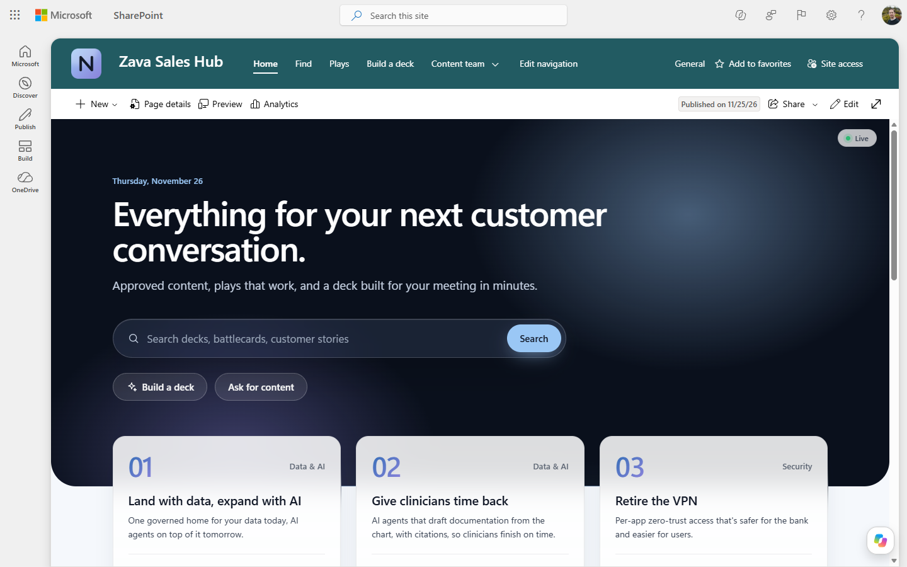
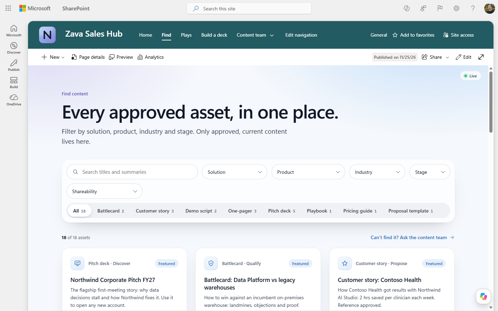
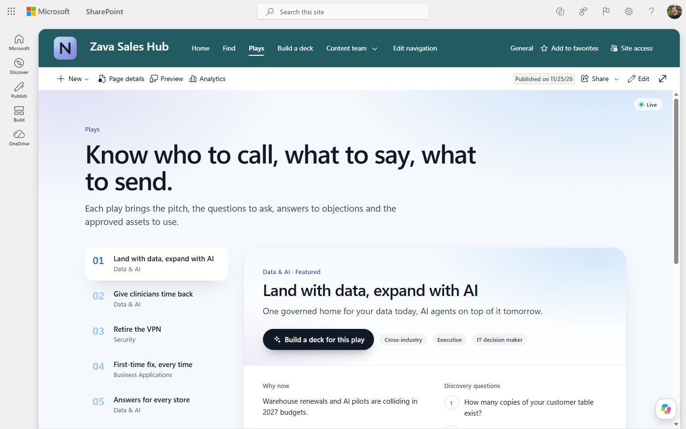
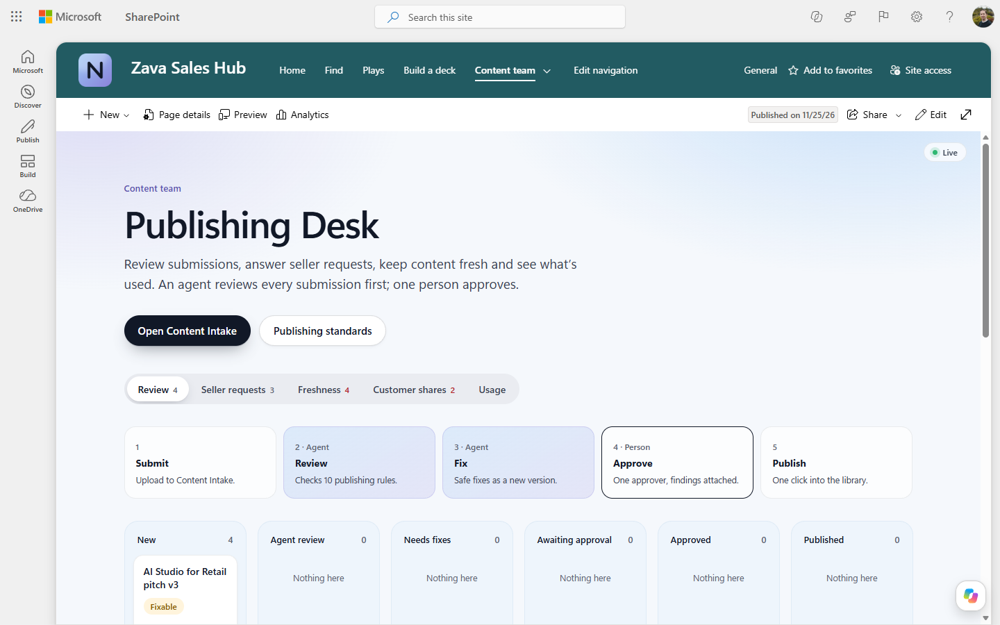
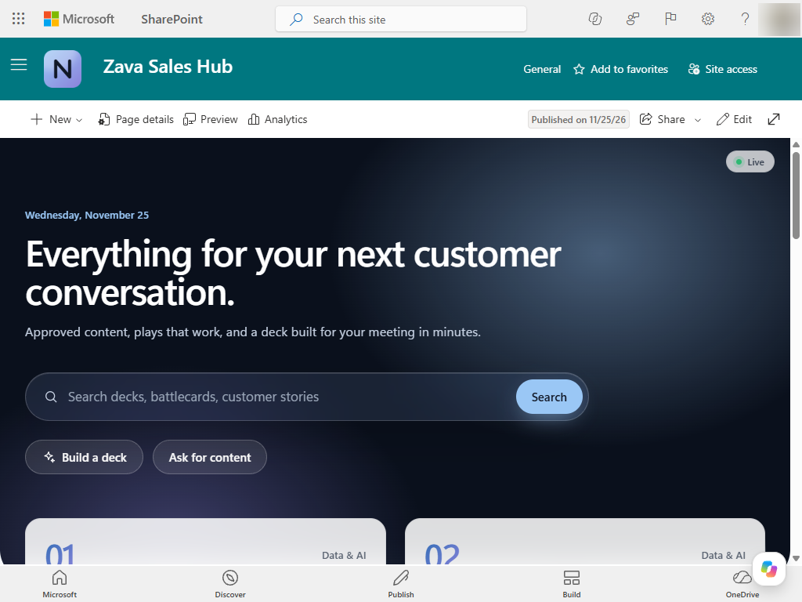
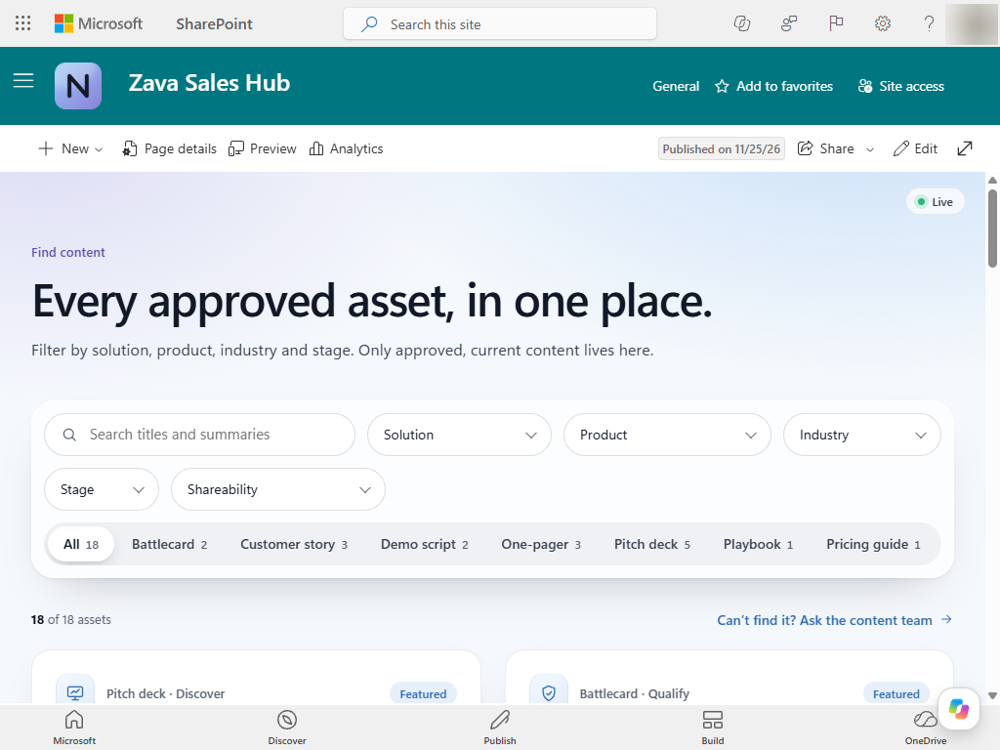
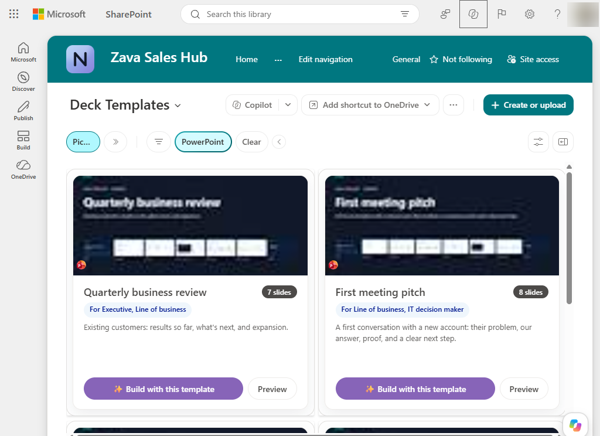
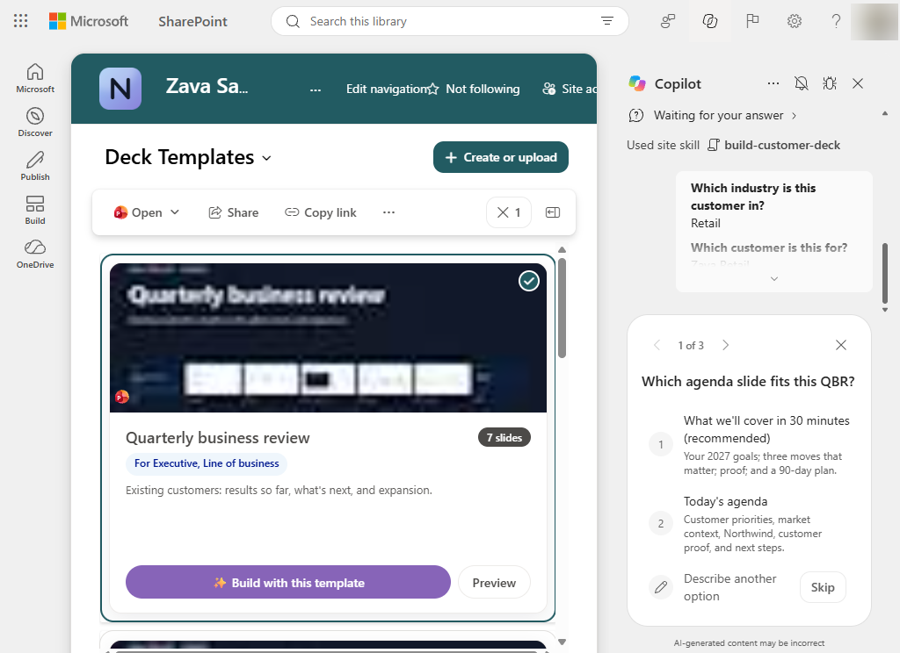
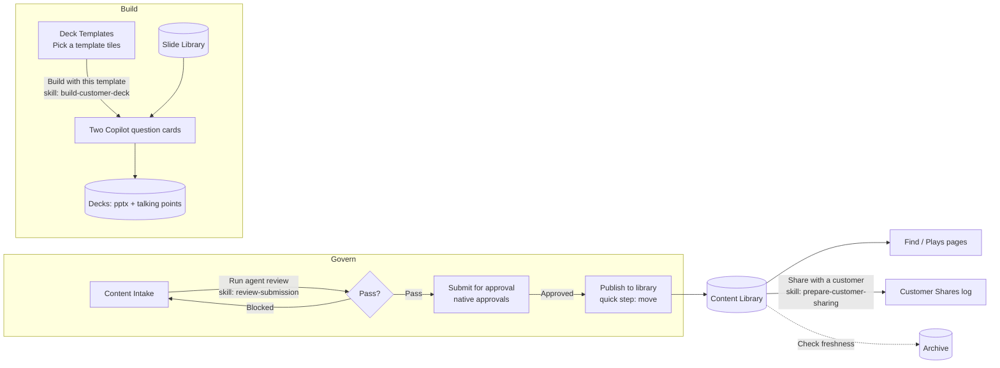

# Northwind Sales Hub: a sales enablement hub built only from SharePoint

A deployable sample of a "basic Seismic or HubSpot" built entirely from SharePoint and Copilot in SharePoint. No custom
code runs on a server, there are no SPFx packages and nothing is hosted outside SharePoint.

The hub has four parts:

- **Find**: approved content, solution plays and a slide gallery, shown on HTML pages that read live list data.
- **Build**: sellers pick a template from a tile gallery and press **Build with this template**. Copilot asks two
  interactive questions, assembles a deck from approved slides only and saves it with talking points.
- **Govern**: content enters through an intake library. An agent review checks it against the publishing standards and
  fixes what is safe. One person approves it, then a single quick step publishes it.
- **Share**: a quick step shares only customer-shareable content, uses view-only links to specific people and logs every
  share.

The sample company is the fictional **Northwind Cloud**, with five products, six solution plays, 28 slides, 5 deck
templates and 18 published assets. All of it is sample data, so you can rebrand it (see [docs/customize.md](docs/customize.md)).

## Live demo walkthrough

The reference deployment walkthrough starts with **Home**, then opens **Find** for approved content, **Plays** for guided selling motions and **Publishing Desk**
for intake, review, approval and freshness. Use **Deck Templates** to try the interactive Copilot deck builder.

| Home | Find |
|---|---|
|  |  |

| Plays | Publishing Desk |
|---|---|
|  |  |



| Find approved content | Pick a template | Copilot builds the deck |
|---|---|---|
|  |  |  |

## What's in the box

| Area | What you get | Where it lives |
|---|---|---|
| Pages | Home, Find, Plays, Slide gallery and Publishing Desk. These are HTML pages with live data and a saved fallback snapshot. | `site/pages/` (built by `tools/page-builder/`) |
| Deck studio | The Decks library's default **Start here** view, a custom HTML view | `site/views/decks-start-here.*` |
| Template gallery | The Deck Templates **Pick a template** tiles view, with a **Build with this template** button on each card | `site/views/deck-templates-pick-a-template.tiles.json` |
| Lists and libraries | 11 definitions covering columns, autofill prompts, views, quick steps and permissions | `site/lists/*.json` |
| Agent skills | `build-customer-deck`, `review-submission`, `publish-approved`, `prepare-customer-sharing`, `freshness-check` and the publishing standards | `site/agent-assets/` |
| Sharing model | Owners, Content Team and Sellers groups, unique permissions per library, item-level security on request lists | `site/site.json`, `site/lists/*.json` |
| Sample content | Slides, templates, published assets, intake submissions, archive files, plays, requests and shares, with metadata | `content/` |
| Deploy | An ordered, tokenized step list (SharePoint IQ plus REST), a PnP PowerShell script, a renderer and a package check | `deploy/` |

## How it works



For the design behind each part, see [docs/architecture.md](docs/architecture.md), [docs/sharing-model.md](docs/sharing-model.md) and
[docs/deck-builder.md](docs/deck-builder.md).

## Requirements

- SharePoint Online and a **communication site** where you are an owner.
- **Copilot in SharePoint**, which runs the quick steps that ask the agent, the site skills and the interactive cards.
- **SharePoint autofill**, which tags intake and slides automatically. Without it, the columns stay manual.
- **SharePoint HTML pages and custom HTML views.** The pages and the Decks view are HTML files that read live data
  through the `ka-livedata-manifest` contract. The reference site was built in the SharePoint dogfood ring, so
  check that these features are available in your tenant first. If they aren't, the lists, quick steps, skills
  and deck builder still work from the standard library views.
- **Native approvals** in lists and libraries.
- One deploy route:
  - **SharePoint IQ**, through Copilot or any MCP client. This is the route that built the reference site.
  - **PnP PowerShell** 2.x or later with an Entra app registration, for the foundation. SharePoint IQ still adds the AI layer.

## Deploy

**Start with the screenshot walkthrough: [docs/setup-walkthrough.md](docs/setup-walkthrough.md).** It follows a real
deploy into a new site, phase by phase, and shows what each phase should look like when it is done.

1. Create a communication site, for example `https://contoso.sharepoint.com/sites/saleshub`.
2. Choose a route:
   - **Copilot Cowork + SharePoint IQ** (tested): put this repo in your Cowork workspace and run
     [deploy/cowork/deploy_run.py](deploy/cowork/README.md) phase by phase. It runs `deploy/steps.json` in order and
     resolves every id. A full run takes about 25 minutes.
   - **Any agent with SharePoint IQ**: paste the agent prompt from [deploy/PLAYBOOK.md](deploy/PLAYBOOK.md). The agent
     follows the same 214 steps.
   - **PnP PowerShell, then SharePoint IQ**: run
     [deploy/pnp/Deploy-NorthwindSalesHub.ps1](deploy/pnp/Deploy-NorthwindSalesHub.ps1). Then follow the "AI layer
     only" section of the playbook to add approvals, quick steps, the tiles card, the form and the deck studio view.
3. Set the theme by hand on the home page: **Settings > Change the look > Theme > Dark teal**.
4. Build one deck end to end, work through [docs/deploy-checklist.md](docs/deploy-checklist.md), then rehearse
   [docs/demo-script.md](docs/demo-script.md).

## Repository layout

```
site/                  declarative definition of the hub (tokenized, tenant-neutral)
  site.json            title, header, theme, navigation, groups, pages, list order, token reference
  lists/               one JSON per list or library: columns (with autofill prompts), views, quick steps, permissions
  pages/               HTML pages (generated; edit through tools/page-builder)
  views/               Decks "Start here" HTML view and its stored formatter; Pick a template tiles JSON
  forms/               Request content form definition
  agent-assets/        site skills and publishing standards (uploaded to the Agent Assets library)
  hub-assets/          slide thumbnails used by pages; branding/ holds the logo and header
content/               sample files per library, plus seed.json (metadata and list rows, relative dates)
deploy/
  steps.json           ordered deploy steps: via iq | rest | manual
  PLAYBOOK.md          how an agent (or a person) runs the steps; the "AI layer only" subset
  cowork/              the Copilot Cowork runner that did the tested deploy, and a tokens example
  pnp/                 PnP PowerShell route
  tools/               render.py (resolve tokens), make_view_formatter.py, check_package.py (CI lint)
tools/
  page-builder/        Python source of the HTML pages and the deck studio view
  content-generators/  Python that generated the sample slides, templates and documents
docs/                  setup walkthrough (with screenshots), architecture, sharing model, deck builder, demo script,
                       customization, known issues, checklist
```

## Tokens

The package contains no tenant-specific values. URLs, list ids, view ids, quick step ids, group ids, the approver and
dates are written as `{{tokens}}`. Deploy fills them in for your site. The full list is in `site/site.json` under
`tokens`. Dates in the sample data are relative to deploy day (`{{Today+90}}`), so "expiring soon" always means soon.

## Status

- **Tested fresh deploy (2026-11-25):** all of `deploy/steps.json` was run into a brand-new communication site in the
  SharePoint dogfood ring with the Cowork runner. Every required step passed. The one optional step (site
  thumbnail) returned HTTP 502. A deck was then built end to end from a template, with all seven detail columns
  filled. The run found two ordering bugs, both fixed here; see the end of
  [docs/setup-walkthrough.md](docs/setup-walkthrough.md).
- The reference site that the package was exported from was also tested end to end for intake, agent review,
  approval and publish, and for sharing with a customer.
- The PnP route has not been run yet. See the TODO markers in the script.
- Known platform behaviours and workarounds are in [docs/known-issues.md](docs/known-issues.md).

## License

MIT. See [LICENSE](LICENSE). Northwind Cloud, Contoso, Woodgrove, Tailspin, Wingtip and Fabrikam are fictitious.
